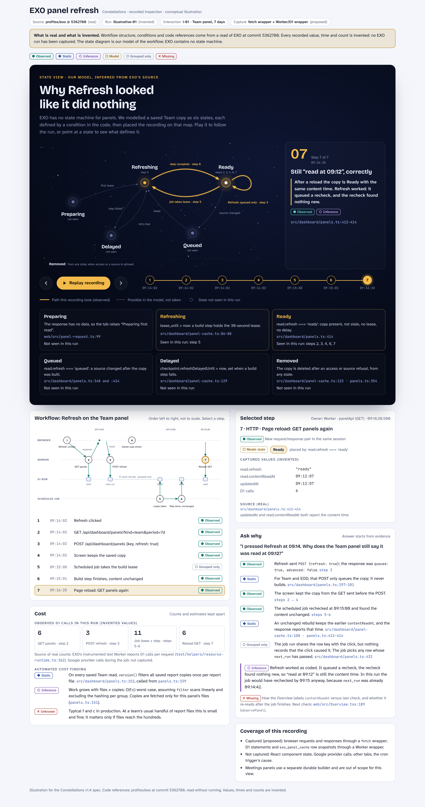
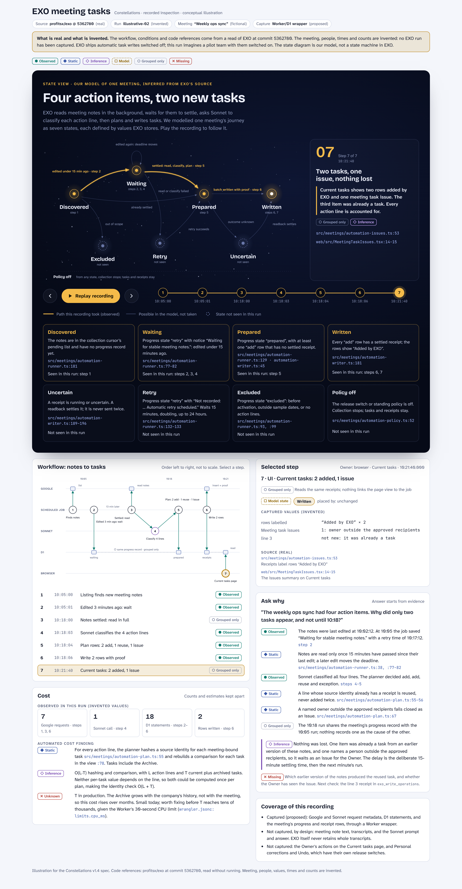

# Constellations v1.4

## Full product specification

13 October 2026 • Source-grounded codebase and workflow exploration

**Changes from v1.3.** State diagrams are defined as models linked to code and recorded evidence; applications need not use reducers or a state-machine library (§4). Reducers are treated as one optional application pattern, relevant mainly to future replay. The EXO paragraph reflects a read-only inspection (§2, §11). Capture guidance notes that the capture point depends on the runtime (§4). No other requirement changed.

### 1. Purpose and product boundary

Constellations is a standalone tool for understanding how an existing codebase works. It connects a navigable system view to real source, recorded events, state changes and computational-cost evidence. An AI assistant helps a developer ask why something happened and inspect the basis of the answer.

The goal is less investigation effort and better understanding. A useful result might explain a healthy design, locate the cause of surprising behavior, or show where evidence is missing. More diagrams, warnings or confident prose are not success by themselves. The longer-term vision also includes feature-impact analysis, branch comparison and automated performance investigation.

**Approved v1 boundary: recorded inspection only.** Constellations v1 reads source and imported recordings. It does not run the application, import transition code for execution, rerun a handler, edit inputs and execute them, or orchestrate a test. Previous and Next move through recorded evidence; they do not rerun or undo external actions.

**Proposed v1 product slice:** scan one codebase on one supported stack, group its frontend, backend and shared systems, follow one real recorded workflow, inspect relevant source, before/after state and a state view of the workflow, answer a real why question, and produce one narrow automated cost insight. These scope recommendations remain open to review; recording-only inspection is the approved decision.

### How to read this specification

- **Product requirements:** standalone exploration, source-grounded explanations, useful state and event investigation, low repeated setup, and AI assistance through the Anthropic API. Automated cost analysis and feature understanding remain part of the full vision.
- **Trust requirements:** evidence provenance, truthful limits, safe imports, protected secrets and approved data use apply wherever the corresponding capability exists.
- **Recommendations:** the first stack, import route, interface arrangement, libraries and evaluation method are candidate choices, not a locked implementation plan.
- **Future capabilities:** execution, replay, broader measurements and change planning are explicitly outside the proposed v1 slice. Their requirements below do not authorize or require a v1 runner.

This is a flexible description of what the product should achieve, not a build checklist, architecture commitment, schedule or budget. It does not authorize implementation, repository inspection or creation, application changes, API spending or transmission of private code. Existing Git/GitHub workflows remain; no migration to another collaboration system is implied.

### What the product is not promising

Constellations does not prove whole-program correctness, enumerate every runtime path, assign one Big O value to a repository, or force an application into a complete finite-state machine. Automatic implementation, production operations, deployment and autonomous repository changes are outside this specification.

<!-- pagebreak -->

## 2. The v1 experience and setup

### Scan and group

The developer selects a codebase they already have, including a small or incomplete project. A local folder is the recommended first route, with one supported stack still to be selected. GitHub/PR and ZIP imports are future options rather than parallel v1 requirements.

Without executing project code, the scan identifies supported languages, packages, frontend and backend areas, shared modules, likely entry points, tests and recognizable state/event conventions. It presents useful partial results and a coverage summary: included, excluded, unsupported and unresolved. It must not install dependencies, evaluate configuration code, load application modules or start the app as a side effect of scanning.

### Follow one real interaction

The developer imports a compatible recording and its matching source snapshot, then selects a workflow. One interactive diagram is the main view; it can include a state view of the workflow (§4). Selecting a meaningful step opens its event or input, real handler/source reference when identifiable, captured before/after state, and contextual explanation. Source, state, cost and evidence details can be nested in an inspector rather than occupying six mandatory panels.

The diagram supports a focused path, reversible expansion, search and grouping from subsystem to file or symbol. Static imports, possible calls and shared contracts remain distinct from recorded runtime links. A shared type does not establish participation in a workflow. No-ops, failures, retries, truncation and unknown connections remain visible. A keyboard-accessible list or outline provides the same essential evidence without depending on color or spatial layout.

### Capture without a new instrumentation project for every feature

The developer runs the application separately, under the authorization and safeguards appropriate to that application. A reusable development capture integration supplies recordings for the selected stack. Existing traces, logging or supported devtools hooks should be reused where compatible. A manual interaction is a valid source of evidence; an existing test may also drive the app. Neither a new test nor a generated end-to-end script is required.

The v1 goal is one reusable capture integration per supported stack, not a handwritten diagram or custom adapter for each feature. If application edits are needed, disclose their files, purpose and maintenance cost and obtain separate approval. Prefer reversible development-only integration; never silently change the original project. Constellations itself does not start the capture run or operate external services in v1.

### Setup should be visible and reusable

Record what was discovered automatically, reused, generated or manually configured: source/recording selection, workflow choice, state projection, capture integration, redaction and any required application changes. Report first-workflow effort separately from marginal effort for a second workflow. The reuse check should show a second real workflow on the same stack without new per-feature engineering.

Allow cancellation, bounded scans, incremental rescans and reuse of compatible results. Unsupported projects receive a precise capability limitation and useful static inspection where possible. The product must not hide setup work behind “automatic.”

**Candidate project:** EXO (profitsx/exo) was inspected read-only on 13 October 2026 at commit 5362780; nothing was installed, built or run. Findings are in §11. Whether EXO is the demonstration project, and whether it is designated trusted, remain undecided. The report-refresh example in §7 is hypothetical; §11 names a real EXO workflow that fits it.

<!-- pagebreak -->

## 3. Evidence, identity and truthful links

### Pin every analysis to its source and recording

An analysis snapshot identifies the repository/import, selected revision and commit SHA when available, plus a digest of included dirty or untracked content. A non-Git import needs an equivalent content digest. Include analyzer/capture-adapter versions, relevant configuration and scan time. A recording additionally identifies its run, interaction or scenario, dataset/input identity where known, environment, capture settings and instrumentation.

Source references resolve to the analyzed snapshot using file path, symbol identity and location where possible. Line numbers alone are insufficient. Preserve exact captured-source identity even if the working tree has moved; mark mismatches or stale results instead of silently binding old evidence to new code. Unresolvable symbols are visible gaps. Future base/head comparisons retain both identities.

### Evidence categories

- **Static:** relationships or candidate behavior derived from source without running it. Reflection, dynamic dispatch, generated code, injection and unresolved imports can limit coverage.
- **Observed:** events, spans or values captured in the identified application run, within the declared capture boundary.
- **Inference:** AI or heuristic interpretation of cited evidence. Name its origin and assumptions; a plausible explanation is not an observation. A state model inferred from source is an inference; a model declared by a named developer is labeled as declared (§4).
- **Replayed, future only:** evidence from separately authorized re-execution, with its own source/run identity and fidelity limits.
- **Proposed, future scenarios:** intended or hypothetical behavior that has not been observed in the current implementation.

Show these categories in explanations, graph details and exports using text and accessible symbols. A relationship's evidence category and its link basis are different: “observed span parent” and “adapter-derived request ID” explain how a connection was established; “static” or “observed” explains the underlying evidence.

### Correlation is not automatically causation

A shared interaction or trace ID groups events. It does not by itself justify an arrow between them. Each link states its basis:

- **Observed relation:** a recorded parent/child span relationship or a captured request/response pairing.
- **Adapter-derived relation:** a supported library identifier or explicit association, naming the adapter and version.
- **Inferred relation:** order, payload similarity or another heuristic; shown distinctly with uncertainty.
- **Missing relation:** an unresolved parent, absent server span or unknown response-to-state association.
- **Grouped only:** shared interaction context with no supported causal relation; show grouping without an arrow.

Independent clocks cannot reliably order frontend and backend activity. Use recorded relationships and per-owner sequence information; disclose clock and timestamp limits. Events that cannot be attributed stay unattributed. Repeated retries remain separate observations. Queues, batches, shared requests and fan-in may appear as explicit gaps in v1 rather than requiring custom support.

### Coverage is part of the answer

Every material finding includes its claim, supporting source/run references, assumptions, uncertainty and useful next check. Report excluded files, unsupported syntax, missing instrumentation, dropped or sampled events and truncated values. A valid link does not prove that the cited material supports a claim. Deterministic checks can validate identity, references and mechanically testable assertions; semantic support may also require human or model judgment, which must be evaluated separately.

<!-- pagebreak -->

## 4. Recorded steps, ownership and capture contract

### Show data from its actual owner

“State” means data held across steps by a named owner, such as a browser store, a component or a database row. Before/after snapshots describe that owner's captured transition, not the entire application's state. Label full captured state versus a projection; even a complete projection can omit values relevant to later behavior.

Backend step data may instead be observations: request parameters, cache key, hit/miss, entry age, query result count or response fields. Name the producing service, cache or database. Request and response values name the boundary and side from which they were captured. Selecting a backend cache step must not imply that it changed frontend state. Other owners' values can appear as clearly labeled context.

Each value or group of values carries owner, capture point, step/sequence and owner-local time, evidence category, and completeness status. Distinguish full, projected, redacted, truncated, unchanged and unavailable. An unavailable before-state cannot be replaced with an inferred snapshot presented as observed.

### State diagrams are models, linked to code and evidence

Constellations shows a state diagram linked to actual code and recorded events. The application does not need to use reducers or a state-machine library; a reducer is one way to implement transitions, not a requirement for the diagram. The diagram is a model, either inferred from source or declared by a named developer, and is labeled as such. It must not imply that the application contains that exact state machine.

Each state is defined by a cited condition over captured values, so recorded steps can be placed in states, and transitions between them shown, as observed evidence. A step whose captured values do not settle its state is shown as unclassified, never assigned by inference.

| Element | Basis | Label |
| --- | --- | --- |
| State names and the diagram | Inferred from source, or declared by a named developer | Model (inferred) or model (declared) |
| Condition that defines each state | A cited condition in source | Static |
| A recorded step's state, and transitions between states | The condition evaluated on captured values | Observed |

A transition is linked to the handler code that can cause it when that code is identifiable; otherwise the link is missing, not guessed.

### What a supported recording contains

The recording format should carry source/run identities, event and span identifiers, link evidence, source mappings when available, state/observation ownership, capture capabilities, exclusions and integrity/validation results. State serialization defines how dates, maps, sets, cycles and binary values are represented. Unsupported functions, DOM nodes, native handles and opaque resources remain explicitly unavailable or summarized. Lossy encoding and redaction are visible.

Import validates schemas, supported versions, bounded size/depth and source correspondence. A mismatched or partially invalid recording yields a precise limitation and safe partial inspection where possible. Parsing or displaying a recording must never execute its contents or embedded code. Recorded import does not undo any effect that occurred during the original application run.

### Reusable capture, with honest limits

OpenTelemetry spans and W3C Trace Context are candidate conventions for request correlation. A capture integration might associate store transitions with library request IDs and pair supported client requests with responses. These are candidate mechanisms, not an implementation mandate or a claim that all clients are covered. The capture point depends on the runtime: a Node preload agent, for example, does not apply to a Cloudflare Worker, where a wrapper around the Worker's request handler and bindings is the natural point.

Capture reports must address relevant blind spots: unwrapped HTTP clients, service workers, WebSockets, third-party SDKs, cross-origin propagation, background polling, dropped events, sampling and asynchronous handoffs. Adding trace headers can change CORS behavior or timing. Inspect recorded capabilities rather than assuming complete capture because dependencies were instrumented.

If a collector is used, treat app-originated events as untrusted input. Keep ingest separate from model credentials and privileged control endpoints. Use a scoped, bounded ingest capability, schema and size limits, safe storage and restricted reachability. Any setup that creates persistent access or changes the application needs its own authorization. V1 does not require a runner or a new collector service if compatible imported evidence is available.

### Counts and absence

“Zero” requires a validated complete capture boundary for the named operation type and interval, including known bypasses, asynchronous completion and loss/sampling status. Instrumenting every dependency found in a manifest and seeing no dropped events is not sufficient by itself. Otherwise say “0 observed; coverage incomplete,” “not captured,” or “unknown.” Count labels must name the run, operation and scope. A scoped complete zero is never a claim about all work in the application.

<!-- pagebreak -->

## 5. Automated cost insight in v1

### Three distinct questions

**Complexity estimates** explain possible growth of a defined unit of work with defined inputs under stated assumptions. **Operation counts** describe selected captured operations in an identified run. **Timings** describe measured durations under the recorded environment and instrumentation. None substitutes for the others. A short trace does not prove an asymptotic bound; favorable Big O does not establish acceptable latency.

The proposed v1 delivers one narrow, automatically recognized complexity pattern with inspectable source, such as repeated linear lookup inside a collection loop. The user should not calculate the estimate or handwrite a benchmark for each feature. Broad complexity inference, fixture generation and multi-size growth experiments remain future work.

### Minimum useful estimate

A finding names the function, transition or other analyzed unit; source snapshot and symbol; input dimensions; loop bounds and relevant callees; path conditions; and whether the claim is worst-case, expected, amortized or input-specific. If a callee or data representation cannot be resolved, narrow the claim or return unknown.

Example, entirely illustrative: an outer loop visits n report rows and a known linear search examines up to m related records for each row. Under those bounds, with constant-time comparisons and no additional dominating work, the lookup portion has an O(nm) worst-case upper bound. Early exit may make the recorded run cheaper. This is a source-based conditional estimate, not a measured runtime result or a whole-function bound unless all material work is covered.

A nested loop alone is insufficient evidence. Loops may share a shrinking range, have constant bounds, exit early or call more expensive operations. A suggested prebuilt lookup is a possible change, not a verified optimization or automatic code edit.

### Use captured counts and timings when available

Show actual recorded cache lookups, queries, requests, transition invocations or other supported operations with definitions and coverage. Do not invent counts from an estimate. Keep inclusive and exclusive scope distinct; avoid counting a child's work as exclusive work in every ancestor. If the recording lacks timing or a count, the UI says so rather than requiring new execution.

When displaying a timing, retain known runtime/dependency versions, dataset/scenario identity, cache state, instrumentation, trial count and resource context. Unknown metadata limits comparison. A single instrumented span can be useful as a recorded observation, but it is not a benchmark. Overlapping spans cannot be added to obtain end-to-end wall time, and incomplete links limit critical-path claims.

### Cost in context

Explain why the finding could matter: repeated work, likely growth dimension or known hot-path frequency. Where evidence is absent, say so. Keep structural complexity, coupling, state/effect complexity and measured runtime cost separate. The product should recognize clear, bounded and appropriate code as well as risks; an opaque quality score is not required.

**V1 output:** one useful, source-grounded cost explanation alongside the recorded workflow, with observed counts/timings only where captured. No fixture generator, growth proof, benchmark orchestrator or broad optimization engine is needed for this slice.

<!-- pagebreak -->

## 6. AI, privacy and safe local inspection

### Grounded assistance

The desired provider is the Anthropic API. A protected local or server-side service supplies bounded, relevant context through read-only retrieval: source/symbol lookup, graph relationships, step data, state diffs and cost findings. A provider abstraction is a candidate engineering choice, not permission to change the requested provider.

Answers separate observed facts, source-derived facts, inferences and unknowns. The user can open each material claim's evidence. Source comments, READMEs, logs and model outputs are untrusted data; embedded instructions cannot grant execution, data sharing or tool permissions. Tool use retrieves evidence and does not authorize arbitrary commands or application changes.

Before private code, state or traces go to Anthropic, obtain approval for the recipient, data classes and bounded scope. Record that approval and material changes in an audit log; approval is not required anew for every retrieval within the same authorized scope. Provide exclusions, disclosure or payload preview, redaction controls and clear local/export retention. Full-repository upload is not the default.

### Secret and cost boundaries

Keep API keys out of browser bundles, source repositories, capture payloads and app/capture processes. Use a protected credential boundary. Known secrets must be excluded before capture/export/model transmission; if safe removal cannot be verified, block the affected operation. Secret scanning can miss values, so it is not a guarantee or a substitute for approved scope. Already imported sensitive content stays local and restricted until handled safely.

Expose budget limits, usage where available, progress and cancellation. Cancellation stops further work as specified while showing already incurred usage. Caches respect source identity, model/prompt versions, permissions and deletion choices. Static exploration remains useful without model calls. Saved conversations and findings inherit their source data's privacy requirements. Check current provider retention, pricing and account settings when configuring the product.

### V1 import and interface security

Read repositories as data, with path and resource bounds. Do not execute package scripts, hooks, configuration code, build tools, tests or imported modules. Safely render source, logs, filenames, imported diagrams and AI output; escape untrusted content and define external-link behavior.

For any local web service, bind to loopback by default, validate Host and Origin, protect against cross-site requests and DNS rebinding, and use scoped session access. Validate canonical paths, approved roots and symlinks; prevent traversal and relevant race conditions. Bound oversized or malicious files and recordings. ZIP-specific extraction defenses apply if ZIP support is later introduced.

Users can inspect and remove stored analysis artifacts and choose retention. Logs and crash reports minimize source and state data. Exports preserve provenance, limits and redactions; an export action does not authorize public sharing.

The developer's separately run app may have its own credentials, dependencies and side effects. V1 must accurately describe that boundary and the capture integration's permissions; it must not imply that importing a recording made the original run isolated or safe. Future execution security is specified separately in §9.

<!-- pagebreak -->

## 7. Conceptual interface example

The example is a hypothetical report refresh, not a finding about EXO or a screenshot of implemented software. Every path, symbol, event, value, count and timing is invented. The diagram demonstrates evidence connections and progressive detail; it does not prescribe the final screen.


### Portable text version

```text
CONSTELLATIONS / report refresh / recorded inspection
Source: demo@a1b2c3 | Run: demo-07 | Interaction: i-12

BROWSER                    SERVICE
refreshRequested --O--> GET /reports --O--> response
                           |                 |
                           O                 A (adapter-derived)
                           |                 |
                       cache.lookup      reportLoaded (BROWSER)
                        [selected]
Shared Report type: STATIC dependency, not runtime handoff
analytics.track: grouped/unattributed; no causal arrow

O = recorded relation  A = adapter-derived request association
? = inferred relation  X = missing relation (never filled in silently)

SELECTED: cache.lookup | owner: report service/cache
Observed: filters region=EU, status=open; key=reports:EU;
          hit; entry age=14 min; result count=120
Source: demo/reportCache.ts :: buildReportKey @a1b2c3
Frontend context at this step: loading=true, rows=0
Frontend change at reportLoaded: loading true->false, rows 0->120
Frontend owner: browser store; captured projection only

WHY older data? Observed hit + source/key evidence support
an inference: status may be omitted from the key.
Check: key construction and invalidation. TTL unavailable.

COST: 1 observed cache lookup; DB calls 0 observed,
coverage incomplete; 0.8 ms captured span, one instrumented trial.
Separate STATIC finding: illustrative row lookup O(n*m),
conditional on known linear search and constant comparison cost.

STATE VIEW: MODEL (inferred from source; not a state machine in the app)
saved copy shown --> refresh requested --> rebuilding --> updated
cache.lookup classified as "saved copy shown" (OBSERVED: hit)
```

A real interface would open evidence from the selected step, preserve the user's place and show the state transition only at the step that owns it. The why answer starts from captured values and cited source before proposing a cause. Missing TTL/invalidation evidence prevents a conclusive root-cause claim. The cost estimate concerns a separate source pattern; it is not inferred from the cache span. The text export remains understandable without the picture.

<!-- pagebreak -->

## 8. Full product vision beyond v1

### Feature planning and branch comparison

For a proposed feature, identify candidate affected subsystems, contracts, state, actions, dependencies and tests, explaining why each was included. Planned behavior appears in a separate overlay. Predicted impact is neither an exhaustive dependency set nor a verified implementation.

For an existing feature branch, require explicit base and head revisions. Explain source, symbol, contract and dependency differences separately from observed behavioral or measured performance changes. Missing traces, incompatible fixtures, renamed symbols and environment differences limit the comparison. Existing Git/GitHub remain the repository workflow; no replacement system is required.

Future outputs may include an architecture summary, workflow explanation, capability report, source-linked findings, feature-impact brief, branch comparison and performance report. Preserve source/run identity, assumptions, evidence categories and limitations in each. V1 needs the applicable workflow, coverage and cost outputs, not every future report.

### Actual-source replay and counterfactual exploration

Keep four modes explicit: static inspection and recorded inspection in v1; isolated execution/replay and counterfactual scenarios later. Future replay executes the actual selected transition implementation, such as a reducer or store handler where the application has one, never an AI-written approximation presented as current behavior. Applications without the appropriate boundary retain limited or recorded-only inspection. Do not invent transition code or model the whole app as a finite-state machine.

A replay adapter defines its entry point, state boundary, input/event format, initial snapshot, effects, expected outputs and fidelity checks. Required context may include clocks, random values, IDs, network responses, timers, asynchronous order, framework scheduling, closures, browser/database state and environment settings. Recorded event order alone does not reproduce concurrency.

Record, stub or mock external effects by default and disclose the realism lost. Compare relevant outputs and state against the capture; divergence is an investigation result. Redaction, lossy serialization or substituted fixtures can change equality, parsing, identity or control flow. If essential values cannot be represented safely, use inspection-only mode or a clearly disclosed substitution.

A matching output and after-state do not establish, or by themselves make likely, the same internal path in the original run. Original branch choices remain unknown unless captured. Coverage collected during replay describes replay only. V8 precise coverage can report execution counts/coverage; it does not capture condition operand values. Those require a distinct supported instrumentation or debugger capability. Neither branch operands nor line-by-line debugging are v1 requirements.

Counterfactuals use edited or generated inputs and remain visibly proposed until executed under the future authorization and isolation rules. Universal replay is not promised; report exactly what is supported and where fidelity ends.

### Broader discovery and reach

Additional languages/import routes, complex queues and fan-in, shared-request adapters, richer distributed workflows, team collaboration, generated E2E orchestration and broader state mechanisms remain expansion candidates. Progress should reduce repeated manual work, not shift it into per-feature adapter maintenance.

<!-- pagebreak -->

## 9. Future measurement and execution safeguards

### Automated performance investigation

The longer-term product should discover loops, repeated searches and sorts, recursion, collection transformations, repeated queries, rendering and recomputation. Infer useful input dimensions from source, schemas, tests, traces and valid fixtures, then suggest meaningful scenarios. It should not require a custom benchmark for every feature. Unknown domain constraints may need user input.

Growth experiments vary independent dimensions where feasible while preserving valid data shape, distribution and selectivity. Separate setup, data generation, compilation/warm-up, execution and teardown. Identify cold/warm caches, repeat trials and show variability. Use low-instrumentation timing runs separately from detailed counting when overhead is material, with comparable workloads and disclosed overhead.

Retain dataset, scenario, runtime/dependency, hardware/resource, cache and instrumentation identity. Distinguish expected, worst-case, amortized and empirical growth claims. Tests across input sizes provide supporting evidence, not proof of asymptotic behavior. Frontend analysis needs framework-specific render/commit and scheduling evidence; backend analysis may need query counts, rows, indexes and plans. Profiling that executes a database statement is execution. A faster result does not establish an optimization's correctness.

### A separate, future execution boundary

No runner is required in v1. Before future execution is offered, establish and review isolation before loading repository code, including import-time effects. A Node worker process or Node vm context alone is not a security boundary. Use an appropriate OS-level sandbox or stronger isolation, read-only source, disposable writes, constrained processes, resource/time limits and termination controls.

Network is off by default. Keep user credentials, home directories, SSH agents, host browser profiles, cloud metadata, production databases, host control sockets and Anthropic credentials inaccessible. Separate dependency acquisition/build policy from application runs. External actions such as emails, payments, production writes and deployment remain blocked; any exception needs a separately designed and authorized workflow.

For a future trusted-repository pilot, containers are an option to evaluate, not a selected v1 dependency or proof against hostile code. Containers share the host kernel. gVisor is a user-space application kernel; Firecracker provides lightweight microVMs. A stronger boundary must be considered before supporting untrusted execution. Repository trust does not make third-party dependencies trusted.

### Future runner and collector conditions

Candidate controls include lockfile-based acquisition with a restricted registry network, no install-time secrets, non-root execution, reduced capabilities, syscall controls, an internal app/service network and explicit non-production environment values. Production-host detection is a supplementary check, not a complete safety boundary; outbound denial still matters. Detected credentials block execution until safely removed from the mount or replaced. Detection can miss secrets.

If capture crosses an isolation boundary, expose only scoped, write-only ingest with strict formats, quotas and per-run access; no route to privileged control services or model credentials. Constellations reads a safe evidence store rather than trusting the runner as a control plane. Published ports are loopback-only and limited to the authorized workflow. Record every relaxation because it changes the run's security and interpretive limits.

Test hostile input, import-time effects, network attempts, filesystem escape, collector abuse and termination. Execution support remains withheld wherever these boundaries cannot be established reliably.

<!-- pagebreak -->

## 10. Acceptance and usefulness

### Proposed v1 acceptance checks

1. **Real workflow, honest coverage.** A developer imports an actual recording tied to its source, sees relevant frontend/backend/shared groups, follows the supported interaction and understands unresolved areas. The walkthrough is not a hand-built feature diagram.
2. **Source and state integrity.** Selecting a step resolves its supported source and owned data. Before/after values are captured, not reconstructed guesses. Wrong revisions, absent values, redaction and unsupported state are visible. Recorded steps enter a model state only through its cited condition; others show as unclassified. Snapshot navigation executes no app code.
3. **Useful why answer.** A real question receives a correct, inspectable answer or a specific uncertainty with a useful next check. Evaluate factual correctness, evidence support and questions answered with evidence separately, so saying “unknown” to everything cannot pass.
4. **One automated cost insight.** The supported pattern is detected with dimensions, source/callees, conditions and limits. Counts/timings appear only when captured and qualified. Include negative examples where the pattern is unknown or the simple estimate would be wrong.
5. **Reusable setup.** A second real workflow on the same supported stack uses the same capture integration without new per-feature engineering. Report first-run effort, incremental effort, user decisions and ongoing maintenance honestly.
6. **Safe failure and privacy.** Import causes no app execution or source mutation. Malformed recordings, malicious rendered text, path escapes, source prompt injection and unrelated-origin access fail safely. Secrets/data scope, budgets and cancellation work as disclosed.
7. **Usability.** Selection/context persist across diagram and inspector. Keyboard and non-color cues work. Errors, no-ops, retries and missing links stay understandable. Partial or larger scans yield bounded, useful results rather than an unreadable whole-repository graph.

Do not invent target percentages, timing budgets or repository limits before observing a baseline. Define and report the supported stack, versions, repository/workflow sample and known gaps. Passing supported cases does not justify universal claims.

### Lightweight v1 usefulness check

Use a real why question with a known, reviewable answer. Record correctness, time to first verified insight, setup effort, unsupported cases and which evidence the developer actually inspected. A comparison with an AI coding assistant answering the same question can be useful, but a formal study is not a v1 gate. A manual demonstration and the second-workflow reuse check can establish whether the slice is worth extending.

### Future formal evaluation

If a larger evaluation is needed, distinguish a **product comparison**, using each tool as people normally would, from an **interface comparison**, matching model/version, evidence, tools and time/token budgets. The first can show usefulness but cannot isolate the interface as the cause. Giving tools the same provider alone does not control those differences.

Use prewritten tasks and grading, independent assessment where possible, rotated task order and developers unfamiliar with the selected area. Measure correct explanations, time including setup, false claims accepted, confidence calibration, verifiable claims, questions answered with evidence and effort/preference. Report small samples as qualitative evidence with supporting numbers. Broader future tests cover replay fidelity, valid growth measurements, feature-impact omissions and regression comparisons separately.

<!-- pagebreak -->

## 11. Open choices, technical candidates and review

### Decisions still open

- Select the first project, real interaction, supported stack/state pattern and import route. Local folder and one stack are recommendations. EXO's inspection (below) supports it as a candidate; the choice is still open.
- Establish how compatible recordings are obtained, which state projection is useful, and the reusable capture boundary. Confirm what already exists before proposing integration work.
- Choose the first explainable cost pattern and conditions under which the analyzer must return unknown.
- Test the primary diagram/inspector experience against simpler navigation; choose packaging, retention defaults, supported repository size and acceptable effort from evidence.
- Decide future priorities only after the v1 experience is useful. Replay, feature impact and broader performance work need separate decisions and authorization.

### EXO inspection findings

Read-only inspection of profitsx/exo at commit 5362780 on 13 October 2026. Nothing was installed, built, run or sent elsewhere. These are facts about the code as read, not about its runtime behavior.

| Topic | Finding |
| --- | --- |
| Stack | TypeScript throughout, Node 24. Backend: a Cloudflare Worker (`src/worker.ts`) with D1 (SQLite), KV and a per-minute cron. Frontend: a React 19 dashboard built with Vite (`web/`). |
| Shared code | Frontend modules import backend modules directly, for example `web/src/panel-request.ts` imports `src/dashboard/team-calendar.js`. |
| Frontend state | No Redux or reducers: component `useState`, four React contexts, one external store, plain same-origin `fetch`. The workflow-relevant state is mainly server-side. |
| Candidate workflow | Overview panels and Refresh: a saved copy shows at once, then the tab advances a background build through repeated `POST /api/dashboard/panels` (`web/src/panel-request.ts`). Backend copies live in `exo_panel_cache`, keyed by a hash of viewer, viewer version, panel kind, query and access rights, with 30-second build leases, delayed refresh and content-read time (`src/dashboard/panel-cache.ts`). Hit and miss metrics already exist. Start with the `team` panel; the meetings builder and cron-advanced builds appear as gaps in v1. |
| Running safely | Local preview scripts run the real Worker on loopback with fictional data and synthetic providers (for example `scripts/preview-overview.mjs`). |
| Driving the interaction | Playwright scripts drive those previews (`scripts/check-dashboard-*.mjs`). |
| Existing counts and timings | The test runtime's instrumented Worker reports D1 calls, D1 bytes and Google calls per request (`test/helpers/resource-runtime.ts`). Panel cache timings: `scripts/measure-panel-cache.ts`, `docs/evidence/panel-cache/measurements.json`. |
| Existing capture design | Server-side debug capture for MCP tool calls with call/request IDs, application events, redaction and an 8 KB cap (`src/debug/store.ts`); it does not cover the dashboard. |
| Cost-pattern candidates | Repeated lookup inside a loop: `src/dashboard/panels.ts:152` (team and EOD path); `src/dashboard/panels.ts:400` and `src/dashboard/panel-meetings.ts:68` (meetings path). Likely bounded in practice; “grows with both lists, small enough to be fine” would be a valid finding. |
| External services | Google (Drive, Sheets, Calendar, Gmail), Anthropic API, HighLevel, OAuth. |
| Secrets and config | No committed secrets found; `.env` and `.dev.vars` are ignored; Cloudflare config uses placeholder IDs. |

Implications for v1 on EXO: before/after state is mainly `exo_panel_cache` rows, captured by extending the existing instrumented-Worker wrapper to record SQL and row changes. The frontend capture records the user action and request/response pairs through a `fetch` wrapper, not React internals. The existing Playwright scripts can drive the recorded interaction. Whether EXO is the demonstration project, and who may designate it trusted before any future execution, remain owner decisions.





### Candidate engineering direction

A local-first service and web UI are plausible. A JavaScript/TypeScript starting stack, TypeScript compiler API or ts-morph, React/Vite, React Flow, Monaco, Fastify, pnpm and SQLite/FTS are candidates. The official Anthropic SDK and bounded tool retrieval could support AI integration. OpenTelemetry/W3C conventions could support recording interoperability. Vitest/Playwright could validate the product without making app orchestration a v1 feature.

These choices may be replaced. Pin and test supported versions rather than assuming compiler or framework APIs are stable. Preserve separable source indexing, evidence storage, capture adapters, retrieval and presentation; add an independently secured execution component only if later authorized. No repository, migration or implementation is chosen here.

### Requested review

Challenge outcomes and contradictions before evaluating libraries. Identify missing evidence, hidden setup, misleading automation, scope that is too broad and unsafe assumptions. For each material issue, give the user consequence and a simpler or stronger alternative. Distinguish blockers, preferences and unanswered questions. Recommend the smallest credible product that preserves the core experience. Review does not authorize repository inspection, implementation, spending or private-code transmission.

### Reference appendix

Official references support concepts and candidate integrations; they are not evidence about EXO. Product behavior remains subject to the scope and safeguards above.

1. [TypeScript compiler API](https://github.com/microsoft/TypeScript/wiki/Using-the-Compiler-API) and [React Flow custom nodes](https://reactflow.dev/learn/customization/custom-nodes): candidate source and diagram integrations.
2. [Redux reducer concepts](https://redux.js.org/usage/structuring-reducers/prerequisite-concepts) and [React useReducer](https://react.dev/reference/react/useReducer): actual reducer semantics for possible future adapters.
3. [OpenTelemetry traces](https://opentelemetry.io/docs/concepts/signals/traces/) and [W3C Trace Context](https://www.w3.org/TR/trace-context/): spans, links and propagation.
4. [V8 coverage](https://v8.dev/blog/javascript-code-coverage): coverage capabilities, distinct from operand capture.
5. [Anthropic tool use](https://platform.claude.com/docs/en/agents-and-tools/tool-use/overview) and [TypeScript SDK](https://github.com/anthropics/anthropic-sdk-typescript): bounded AI integration candidates.
6. [Node vm](https://nodejs.org/api/vm.html), [gVisor architecture](https://gvisor.dev/docs/architecture_guide/intro/) and [Firecracker](https://firecracker-microvm.github.io/): future isolation considerations.
